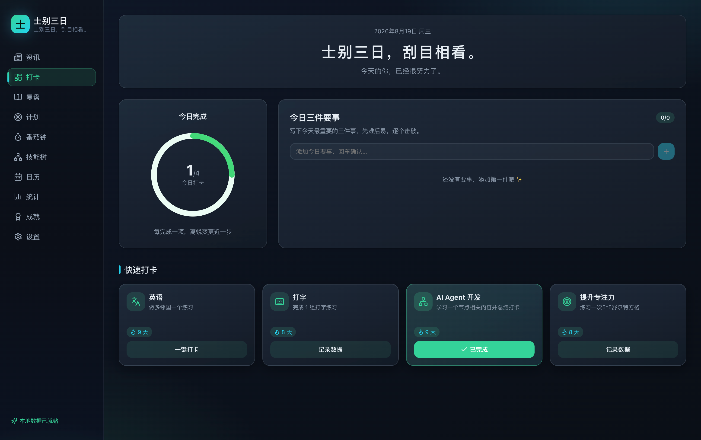
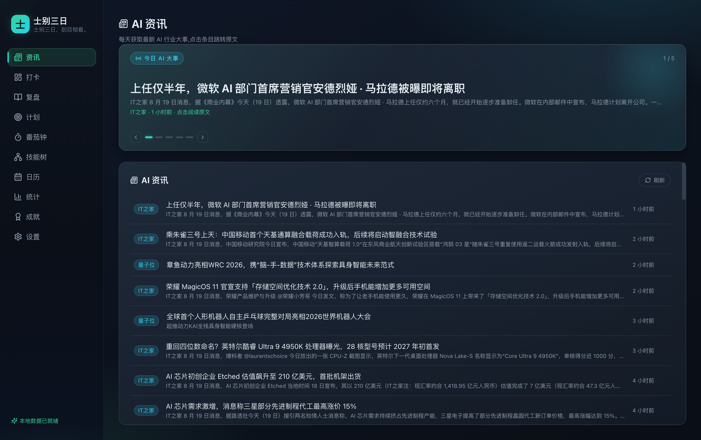
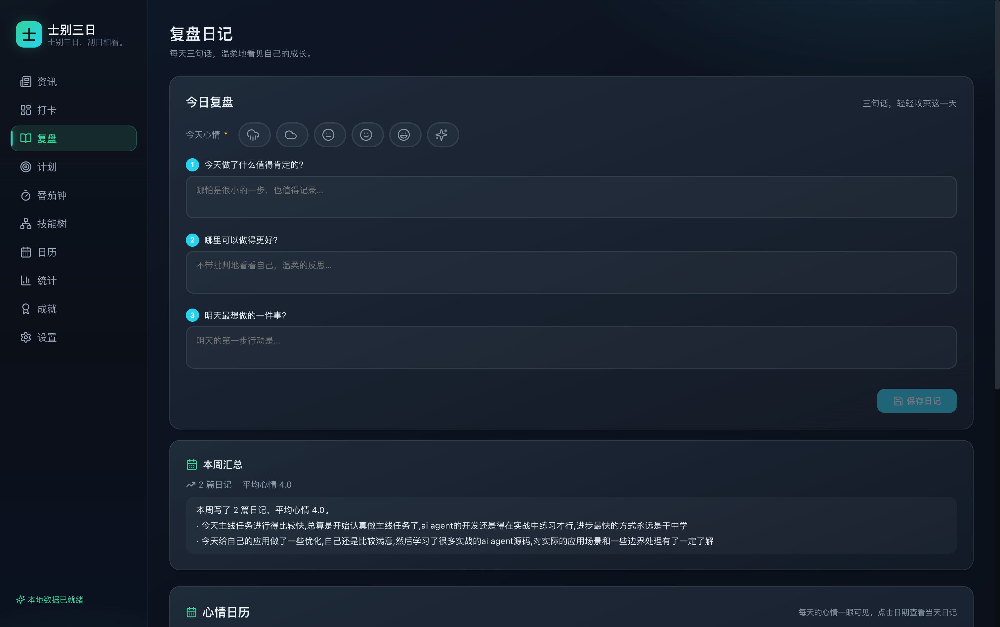
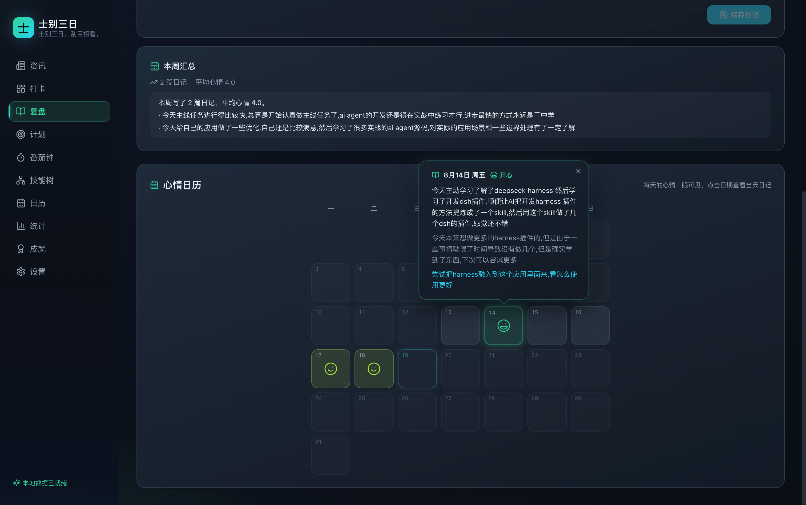
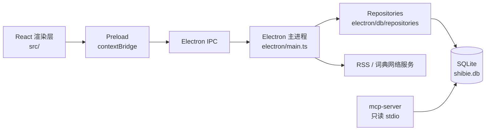

# 厚积薄发 

> 厚积薄发，日日精进。

这是一个基于 **Electron + React + TypeScript + SQLite** 构建的本地优先自律工作台。它把计划、每日打卡、番茄钟、复盘日记、技能树、成就、AI 资讯和学习证据集中在一个桌面应用中，目标是帮助用户把长期目标拆成每天可以完成的小行动。

项目当前采用本地存储模式：核心数据保存在本机 SQLite，不要求注册账号，也没有云端同步或遥测服务。应用会访问公开 RSS 源获取资讯；英语学习模块在查询单词时会访问有道公开词典接口和 dictionaryapi.dev。

> **名称说明**：仓库 npm 包名为 `believe_in_yourself`，Electron 标识和数据库使用 `shibie`，界面中文品牌由代码常量控制。不同配置文件中的名称存在历史差异，不影响运行。

## 截图预览

| 今日打卡 | AI 资讯 |
|:---:|:---:|
|  |  |

| 复盘日记 | 心情日历 |
|:---:|:---:|
|  |  |

## 功能概览

- **AI 资讯聚合**：聚合机器之心、量子位、AIbase、36氪、虎嗅、IT之家等 RSS 源；对综合资讯源按 AI 关键词筛选，支持头条轮播、列表浏览、跳转原文，并在启动时及每 6 小时刷新。
- **今日打卡**：展示当天整体完成度、计划卡片和三只“青蛙”（今日最重要的三件事），支持布尔型和数值型计划。
- **学习证据**：为打卡记录附加截图或视频；图片上限 10 MB，视频上限 500 MB，附件存储在本地 `attachments/` 目录。
- **打卡日历**：按月查看计划完成情况，支持连续打卡、完成率、年度热力图等统计。
- **番茄钟**：支持专注、短休息、长休息循环，默认配置为 25/5/15 分钟，每 4 轮进入长休息；支持关联计划、全屏专注模式和系统通知。
- **复盘日记**：每天记录三句话和六档心情，提供历史日历和周总结视图。
- **英语学习**：英语计划支持单词释义查询、发音播放、复习池、答题记录和学习统计。
- **AI Agent 技能树**：内置 8 层 35 个技能节点，支持节点状态和学习备注维护。
- **统计与成就**：使用 ECharts 展示完成率、热力图、WPM 趋势等数据，并根据打卡和专注情况解锁勋章。
- **数据导入导出**：支持导出 SQLite 数据库和设置快照，也支持从备份导入并覆盖当前数据。
- **只读 MCP Server**：可选的 `mcp-server/` 子包通过 stdio 向 Claude Code、Cursor、DeepSeek Harness 等 MCP 客户端暴露成长数据查询工具，供外部 AI 做趋势分析。

## 技术架构



### 分层职责

- **渲染层 `src/`**：React 页面、业务模块、数据 hooks、Zustand 状态和 Less 样式。
- **Preload `electron/preload.ts`**：通过 `contextBridge` 暴露类型化的 `window.api`，渲染层不直接访问 Node.js 或 SQLite。
- **主进程 `electron/main.ts`**：创建窗口、注册 IPC、处理通知、全屏、附件协议、数据导入导出和外部链接。
- **数据层 `electron/db/`**：使用 `better-sqlite3`，通过版本化 migration 建表，并由各 Repository 封装查询和写入。
- **共享层 `shared/`**：维护类型、API 契约、常量、技能树、默认计划和日期工具，供主进程与渲染层复用。
- **MCP 子包 `mcp-server/`**：独立 Node.js 进程，以 `PRAGMA query_only = ON` 只读访问同一 SQLite 数据库。

## 技术栈

| 层次 | 技术 |
|---|---|
| 桌面框架 | Electron 31 |
| 前端 | React 18、TypeScript、Vite、electron-vite |
| 样式 | Less、主题变量、深色 UI |
| 本地数据库 | better-sqlite3、SQLite WAL |
| 状态管理 | Zustand |
| 图表 | ECharts |
| 图标 | lucide-react |
| RSS 解析 | fast-xml-parser |
| 原生模块构建 | electron-rebuild |
| 可选 AI 数据接口 | Model Context Protocol SDK、Zod |

## 快速开始

### 环境要求

- Node.js：建议使用 Node.js 20 LTS 或更高版本。
- npm：随 Node.js 安装即可。
- `better-sqlite3` 是原生模块，依赖安装和打包需要本机编译/预构建环境。

### 安装与开发

```bash
# 安装依赖；postinstall 会尝试重建 better-sqlite3
npm install

# 启动 Electron 开发环境
npm run dev

# 类型检查
npm run typecheck
```

首次启动时，主进程会自动完成数据库 migration，并幂等地写入默认计划、技能节点和成就数据。也可以单独执行：

```bash
npm run seed
```

### 常用命令

| 命令 | 用途 |
|---|---|
| `npm run dev` | 启动开发环境 |
| `npm run build` | 构建 Electron 主进程、Preload 和 Renderer |
| `npm run preview` | 预览构建产物 |
| `npm run typecheck` | 执行 Node 与 Web 两套 TypeScript 检查 |
| `npm run seed` | 执行数据库 migration 和幂等 seed |
| `npm run rebuild` | 重新编译 `better-sqlite3` 以匹配 Electron ABI |
| `npm run mcp:build` | 构建 MCP Server |
| `npm run mcp:start` | 启动已构建的 MCP Server |
| `npm run build:mac` | 构建 macOS DMG |
| `npm run build:win` | 构建 Windows NSIS 安装包 |
| `npm run build:linux` | 构建 Linux AppImage |

当前 `package.json` 未提供独立的 `test` 脚本，日常验证以 `npm run typecheck` 和 `npm run build` 为主。

### macOS 注意事项

`postinstall` 会尝试对 Electron 做 ad-hoc 重签名并移除 quarantine 属性，以减少未签名 Electron 被 XProtect/Gatekeeper 拦截的概率。如果仍然无法启动，可以手动执行：

```bash
npm run dequarantine
```

## 项目结构

```text
.
├─ electron/
│  ├─ main.ts                 # Electron 主进程入口、IPC 和系统能力
│  ├─ preload.ts              # contextBridge API
│  ├─ db/
│  │  ├─ connection.ts        # SQLite 连接、WAL 和 migration 调度
│  │  ├─ migrations.ts        # 版本化表结构迁移
│  │  └─ repositories/        # plans/checkins/journal/pomodoro 等数据访问层
│  ├─ news/newsService.ts      # RSS 抓取、过滤、去重和定时刷新
│  └─ vocab/                  # 英语词典查询服务
├─ src/
│  ├─ App.tsx                 # 侧栏导航和模块路由
│  ├─ modules/                # dashboard、news、plans、habits、timer、stats 等页面
│  ├─ hooks/                  # 业务数据 hooks
│  ├─ store/                  # Zustand 全局状态
│  ├─ theme/                  # Less 变量和 ECharts 主题
│  └─ utils/                  # 平台、图标、图表初始化工具
├─ shared/
│  ├─ types/                  # 共享领域类型
│  ├─ contracts/              # API / Repository 契约
│  ├─ constants/              # 应用常量、默认计划、技能树和成就
│  └─ utils/                  # 日期等共享工具
├─ mcp-server/
│  ├─ src/index.ts            # 只读 MCP 工具实现
│  └─ README.md               # MCP 独立使用说明
├─ docs/screenshots/          # README 截图
├─ scripts/                   # 安装、卸载、图标和 postinstall 脚本
├─ electron-builder.yml       # electron-builder 打包配置
└─ package.json               # 根项目脚本和依赖
```

## 数据与隐私

### 数据库位置

数据库文件名为 `shibie.db`，默认位于 Electron `userData` 目录：

| 平台 | 默认路径 |
|---|---|
| macOS | `~/Library/Application Support/shibie/shibie.db` |
| Windows | `%APPDATA%/shibie/shibie.db` |
| Linux | `~/.config/shibie/shibie.db` |

附件位于同级目录下的 `attachments/`。数据库使用 SQLite WAL 模式，主进程负责写入，MCP Server 可以并发只读查询。

### 已实现的数据表

migration 当前覆盖以下核心数据：

- `plans`：计划和计划配置
- `checkins`：每日打卡、数值、备注和附件元数据
- `frogs`：每日三件要事
- `pomodoro_sessions`：番茄钟会话
- `journal_entries`、`weekly_summaries`：复盘日记和周总结
- `skill_nodes`：技能树节点进度
- `achievements`：成就及解锁记录
- `settings`：应用设置
- `news_items`：资讯缓存
- `vocab_words`、`vocab_reviews`：英语词汇和复习记录
- `schema_version`：migration 版本

### 网络行为

- RSS：应用会请求内置公开 RSS 源，获取和缓存资讯标题、摘要、发布时间及链接。
- 英语词典：首次查询单词时优先访问有道公开接口，失败后使用 dictionaryapi.dev；释义写入本地后，复习流程优先读取本地数据。
- 不上传计划、打卡、日记、统计等用户数据到项目自有服务器；项目本身不包含账号体系和云端同步。

## MCP Server

MCP Server 是可选能力，位于 `mcp-server/`，与主应用使用不同的 Node.js 依赖环境。它提供 12 个只读工具：

`get_overview`、`list_plans`、`get_streak`、`get_heatmap`、`get_checkins`、`get_pomodoro_sessions`、`get_focus_stats`、`get_journal`、`get_skill_progress`、`get_achievements`、`get_frogs`、`get_db_info`。

### 构建

```bash
cd mcp-server
npm install
npm run build
node dist/index.js
```

或者在项目根目录执行：

```bash
npm run mcp:build
npm run mcp:start
```

### 配置 MCP 客户端

以标准 stdio 配置为例：

```json
{
  "mcpServers": {
    "shibie": {
      "command": "node",
      "args": ["/absolute/path/to/mcp-server/dist/index.js"],
      "env": {
        "SHIBIE_DB_PATH": ""
      }
    }
  }
}
```

`SHIBIE_DB_PATH` 留空时使用各平台默认路径；如果数据库位于其他位置，填写 SQLite 文件的绝对路径。完整的客户端配置和验证示例见 [`mcp-server/README.md`](mcp-server/README.md)。

> **注意**：根项目和 `mcp-server/` 各自依赖 `better-sqlite3`。根项目版本会按 Electron ABI 重建，MCP Server 需要按普通 Node.js ABI 安装，不能简单合并两套 `node_modules`。

## 打包发布

```bash
# macOS DMG
npm run build:mac

# Windows NSIS
npm run build:win

# Linux AppImage
npm run build:linux
```

构建产物输出到 `release/`。由于 `better-sqlite3` 是原生模块，建议在目标平台构建对应安装包；不能假设一个平台生成的包可以直接跨平台运行。

## 设计约定

- **主进程持有数据库**：渲染层通过 `contextBridge` + IPC 访问数据，关闭 `nodeIntegration`。
- **版本化 migration**：每次启动读取 `schema_version`，按顺序执行未应用的迁移。
- **本地优先**：核心数据和附件保存在本机，支持手动导入导出备份。
- **每日 04:00 作为日切点**：日期工具和打卡逻辑统一使用该重置时间。
- **连续打卡有“今日宽限”**：连续天数计算允许当天尚未打卡时从昨天继续计算。
- **软删除**：业务数据使用 `deleted_at` 保留历史记录，查询层默认过滤已删除数据。
- **MCP 只读**：MCP 使用 `query_only`，只提供分析数据，不提供修改用户数据的工具。

## 验证状态

已在当前工作区执行并通过：

```text
npm run typecheck
npm run build
```

## 许可证

本项目使用 [MIT License](LICENSE)。资讯内容版权归原始发布者所有，项目仅聚合公开 RSS 元数据并提供原文链接。
